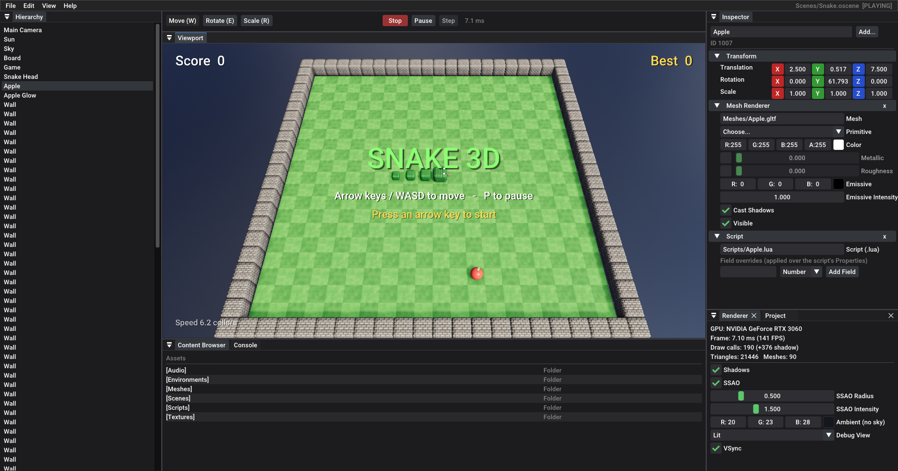

# Snake 3D — built with the Ouroboros engine

**Ouroboros** is a compact, production-minded 3D game engine:

- **C++20 / CMake** for Windows, Linux and macOS
- **Vulkan 1.3** rendering through NVRHI:
  - PBR materials with glTF 2.0 import
  - Image-based lighting from HDRIs
  - Cascaded soft shadows (PCSS)
  - SSAO
  - HDR pipeline with ACES tonemapping
- **ECS** scenes (EnTT) saved as JSON
- **Jolt** physics, **miniaudio** audio and **Lua 5.4** scripting
- An **editor** with docking panels, a transform gizmo, play mode and one-click game export. Agents can drive it completely through a local JSON API (`Tools/obctl.py`).

**Snake 3D** (`SnakeGame/`) is a classic snake game on a 3D board. The snake moves smoothly between cells, and the game includes a HUD and sound. When you crash, the snake bursts into physics-driven pieces.



## Quick start

Install the [Vulkan SDK](https://vulkan.lunarg.com/), then:

```bash
cmake --preset windows                 # or: cmake --preset ninja   (Linux/macOS)
cmake --build --preset windows-release
build/windows/bin/Release/OuroborosRuntime --project SnakeGame/Snake.oproj    # play
build/windows/bin/Release/OuroborosEditor  --project SnakeGame/Snake.oproj    # edit
ctest --preset windows-release                                                # test
```

Controls: arrow keys or WASD to steer, P to pause, Space to play again.

To export a standalone build, use **File → Export Game** in the editor, or `python Tools/obctl.py project.export '{"output": "Exports/Snake3D"}'`.

## Documentation

- [AGENTS.md](AGENTS.md) covers the architecture, code style, building and testing, the file formats, the scripting API and the agent automation API.
- `.claude/skills/` has task guides for AI agents: building and testing, driving the editor, extending the engine, and code review.

## Credits

- The HDRI "Kloofendal 48d Partly Cloudy (Pure Sky)" is from [Poly Haven](https://polyhaven.com/a/kloofendal_48d_partly_cloudy_puresky) (CC0).
- The game's meshes, textures and sounds are generated by `Tools/GenerateAssets.py`.
- Third-party libraries are fetched at build time under their own licenses; see `cmake/Dependencies.cmake`.
