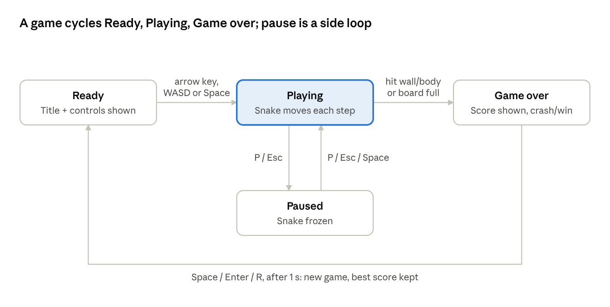

# Snake 3D — Functional Specification Document (FSD)

Oct 21, 2026 · Tito Tamaro

## 1. Document control

This FSD describes what Snake 3D and its toolchain do, as seen by players, designers and agents. It refines the business requirements (BR-xx) in the [BRD](BRD.md) and is refined in turn by the [SRS](SRS.md).

| Item | Value |
| --- | --- |
| Version / status | 1.0 · Draft for review |
| Source baseline | [titotamaro/Snake3D](https://github.com/titotamaro/Snake3D), commit 26f97f6 (16 Oct 2026) |
| Related documents | [Snake 3D — BRD](BRD.md); [Snake 3D — SRS](SRS.md) |
| Author | Tito Tamaro |

## 2. Overview and actors

Snake 3D is a single-player Snake game on a 20 × 20 grid, rendered in 3D. The snake moves one cell per step, grows by eating apples, speeds up as the score rises, and dies on hitting a wall or itself. Filling the board wins.

| Actor | Uses | Goal |
| --- | --- | --- |
| Player | Exported game (Ouroboros Runtime) | Play, beat the best score |
| Designer / developer | Ouroboros Studio editor | Build and test scenes and scripts, export builds |
| AI agent | Editor JSON API (port 7420), `obctl.py` | Inspect, change and test the game automatically |
| CI / QA | Headless runtime and editor, `ctest` | Verify every change |

## 3. Game flow

The game manager is always in exactly one of four states; the keys on each arrow are the only way to move between them.

*Game states · 4 states, 5 transitions*

Score and best score stay on screen in every state. Restart returns to Ready, so the player can choose their first direction.

## 4. Gameplay functions

All gameplay is driven by two Lua scripts: `SnakeLogic.lua` (pure rules) and `GameManager.lua` (input, timing, visuals, audio, HUD). Tunable values are script properties a designer can override per scene.

**Tunable parameters**

| Parameter | Default | Meaning |
| --- | --- | --- |
| GridSize | 20 | Board is GridSize × GridSize cells |
| InitialLength | 4 | Starting snake length (capped at GridSize / 2) |
| StepTime | 0.16 s | Time per move at score 0 (6.25 cells/s) |
| MinStepTime | 0.065 s | Fastest step (about 15.4 cells/s) |
| SpeedUp | 0.004 s | Step-time reduction per apple |
| CameraFollow | 0.18 | How far the camera drifts toward the head |
| MusicVolume | 0.35 | Background music level |

### 4.1 Board and entities (BR-01)

- FR-G01: The board is a GridSize × GridSize grid centred on the world origin; cell (x, y) maps to world (x − 9.5, 0.4, y − 9.5) on a 20-grid.
- FR-G02: A ring of wall blocks is generated around the board at game start (one block per border cell, including corners).
- FR-G03: The scene must contain entities named "Snake Head" and "Apple"; otherwise the game manager reports an error.
- FR-G04: A new game places a straight snake with its head at the board centre, body extending left, moving right.

### 4.2 Controls (BR-01, BR-04)

| Key | Ready | Playing | Paused | Game over (after 1 s) |
| --- | --- | --- | --- | --- |
| Arrow keys / W A S D | Start and turn | Turn | — | — |
| Space | Start | — | Resume | Restart |
| P / Escape | — | Pause | Resume | — |
| Enter / R | — | — | — | Restart |

- FR-G05: A turn is queued, not applied at once; up to 2 turns can be queued and one is applied per step. This lets fast players make tight U-turns.
- FR-G06: A turn into the opposite direction, or the same direction, of the last queued heading is ignored.
- FR-G07: An accepted turn plays the turn sound.

### 4.3 Movement and collision (BR-01)

- FR-G08: The snake advances one cell each step. Between steps, the head and every segment glide smoothly (interpolated), and the head rotates toward its new heading.
- FR-G09: Moving outside the board ends the game (wall collision).
- FR-G10: Moving into any body cell ends the game, except the tail cell that is vacated in the same step (unless the snake is eating).
- FR-G11: Body segments taper toward the tail, down to 65% of head size.

### 4.4 Apples and scoring (BR-02)

- FR-G12: One apple is always on the board, on a random free cell. It spins and bobs in place.
- FR-G13: Eating an apple adds 1 point, grows the snake by 1 segment, plays the eat sound and respawns the apple.
- FR-G14: If no free cell is left after eating, the player wins.
- FR-G15: The best score is the highest score reached in the current session. It is not saved between launches.

### 4.5 Difficulty (BR-03)

- FR-G16: Step time = max(MinStepTime, StepTime − SpeedUp × Score). With defaults, the speed cap is reached at 24 apples.

### 4.6 Pause, game over and restart (BR-04)

- FR-G17: Pausing freezes the snake and shows "PAUSED".
- FR-G18: On death, the head and every segment become physics bodies flung away from the head (crash effect), and the game-over sound plays.
- FR-G19: On a win, "YOU WIN!" shows in gold; no crash effect.
- FR-G20: Restart is accepted only 1 second after game over, to prevent accidental restarts. Restart removes debris and starts a new game; the best score is kept.

### 4.7 HUD (BR-02)

| Element | Position | When shown |
| --- | --- | --- |
| Score N | Top left, white | Always |
| Best N | Top right, gold | Always |
| Speed X.X cells/s | Bottom left, faded | Always |
| SNAKE 3D title + controls + "Press an arrow key to start" | Centre | Ready |
| PAUSED | Centre | Paused |
| GAME OVER (red) or YOU WIN! (gold) + final score | Centre | Game over |
| Press Space to play again | Centre | Game over, after 1 s |

### 4.8 Audio-visual feedback (BR-05)

| Event | Sound | Volume | Visual |
| --- | --- | --- | --- |
| Scene start | Music.wav (looping) | 0.35 | — |
| Turn accepted | Turn.wav | 0.4 | Head rotates |
| Apple eaten | Eat.wav | 0.7 | Snake grows, apple moves |
| Death | GameOver.wav | 0.8 | Physics crash effect |
| Win | Eat.wav | 1.0 | YOU WIN! |

- FR-G21: The camera smoothly follows the head by a fraction (CameraFollow) of its offset from the board centre.

## 5. Toolchain functions

The toolchain lets people and agents build, test and ship the game without touching C++.

### 5.1 Editor — Ouroboros Studio (BR-10)

- FR-E01: Opens a project with `--project <file.oproj>` and loads its start scene.
- FR-E02: Docking panels: Scene Hierarchy, Inspector (all components editable), Content Browser, Console, Viewport.
- FR-E03: Viewport camera: right mouse orbits, middle mouse pans, wheel zooms, right mouse + WASD flies; F focuses the selection.
- FR-E04: Transform gizmo: W translate, E rotate, R scale, Q hide.
- FR-E05: Entity actions: create, rename, duplicate (Ctrl+D), delete (Del); add/remove components.
- FR-E06: Ctrl+S saves the scene to its `.oscene` file.
- FR-E07: Click-to-select in the viewport; selected entity drawn with an outline.

### 5.2 Play mode (BR-10)

- FR-E08: Ctrl+P plays a copy of the edited scene with scripts, physics and audio running; stopping discards play-mode changes.
- FR-E09: Play mode can be paused and stepped frame by frame.

### 5.3 Runtime player (BR-06, BR-07)

- FR-R01: Runs the project's start scene (or `--scene`) in a 1280 × 720 window titled "Snake 3D", VSync on.
- FR-R02: No editing UI is available in the runtime.
- FR-R03: Test options: `--headless`, `--frames n`, `--screenshot file.png`, `--size WxH`, `--test` (non-zero exit code on any script, logged or validation error), `--validation`, `--debug-view 0–5`, `--no-audio`.

### 5.4 Game export (BR-07)

- FR-X01: File → Export Game (or the `project.export` command) writes a folder containing the runtime executable, engine resources, the project's Assets and a `Game.oproj`.
- FR-X02: The exported build runs without the editor or source tree.
- FR-X03: Export failure is reported with a reason and leaves no partial success message.

### 5.5 Agent automation API (BR-12)

- FR-A01: The editor listens on 127.0.0.1:7420 (configurable with `--port`, disabled with `--no-server`).
- FR-A02: Protocol: one JSON request per line, `{id, cmd, args}`; reply `{id, ok, result}` or `{id, ok:false, error}`. Requests run in order.
- FR-A03: Command groups: general, editor, scene, entity, component, script/input, project/asset, renderer/log (full list in SRS §7.3).
- FR-A04: `--exec file.jsonl` runs a command script; `--headless` runs the editor without a window.
- FR-A05: `Tools/obctl.py` sends any command from a terminal.
- FR-A06: `help` returns the live command list.

## 6. Use cases

Five use cases cover the main paths; each lists its trigger, main flow and outcome.

**UC-01 Play a game** — Actor: Player

1. Player launches the exported game; the Ready screen shows title and controls, music starts.
2. Player presses an arrow key or WASD; the snake starts moving in that direction (or Space starts it moving right).
3. Player steers to eat apples; score and speed rise.
4. Snake hits a wall or itself; it bursts apart and GAME OVER shows with the final score.
5. After 1 second, the player presses Space, Enter or R; a new game starts with the best score kept.

Alternate: 4a. The snake fills the board → YOU WIN! shows.

**UC-02 Pause and resume** — Actor: Player

1. While playing, player presses P or Escape → PAUSED.
2. Player presses P, Escape or Space → play continues from the same position.

**UC-03 Tune and test the game in the editor** — Actor: Designer

1. Designer opens `Snake.oproj` in the editor and selects the "Game" entity.
2. Designer overrides a script property (e.g. StepTime) in the Inspector.
3. Designer presses Ctrl+P, plays, then stops; the edited scene is unchanged by play.
4. Designer saves with Ctrl+S.

**UC-04 Export a release** — Actor: Developer

1. Developer chooses File → Export Game and an output folder.
2. Editor writes the standalone build and logs the file count.
3. Developer zips and distributes the folder.

**UC-05 Automated gameplay check** — Actor: AI agent

1. Agent starts the editor headless and connects to port 7420.
2. Agent sends `editor.play`, then `input.tap` with arrow keys, then `editor.step`.
3. Agent reads `game.ui` and `script.exec` results to check score and state.
4. Agent checks `log.get {level: "error"}` is empty and `editor.screenshot` looks right, then `editor.quit`.

## 7. Error handling and edge cases

The product never crashes on bad user data; it logs the problem and carries on where it can.

| Situation | Expected behaviour |
| --- | --- |
| Two keys pressed in one frame | First matching binding wins (Up, Down, Left, Right order) |
| More than 2 turns queued | Extra turns ignored, no sound |
| Reverse turn (e.g. Left while moving Right) | Ignored |
| Head moves into the cell the tail just left | Allowed, no death |
| Frame takes longer than a step (lag spike) | Several steps run in that frame so game speed stays correct |
| Board full after eating | Win; apple hidden |
| Restart pressed within 1 s of game over | Ignored |
| Scene missing "Snake Head" or "Apple" | Script error logged with a clear message; that callback is disabled |
| Lua runtime error in any script | Logged as `[Script] …`; the failing callback is disabled for that entity only |
| Missing or invalid asset, scene or project file | Error logged with the path and reason; no crash |
| Invalid agent command or arguments | Reply `ok: false` with an error message |
| Export to an unwritable folder | Export fails with a logged reason |

## 8. Acceptance criteria

Release 1.0 is accepted when every criterion below passes; most are already covered by automated tests.

| ID | Criterion | Verified by |
| --- | --- | --- |
| AC-01 | A new game shows a 4-segment snake at the centre and an apple on a free cell | SnakeLogicTests.lua |
| AC-02 | Reverse and duplicate turns are rejected; at most 2 turns queue | SnakeLogicTests.lua |
| AC-03 | Eating grows the snake by 1 and scores 1 | SnakeLogicTests.lua |
| AC-04 | Wall and body collisions end the game; following the tail does not | SnakeLogicTests.lua |
| AC-05 | Filling the board returns a win | SnakeLogicTests.lua |
| AC-06 | The start scene plays 240 frames with zero errors and zero validation errors | SnakeGameSmoke |
| AC-07 | Every component and the whole scripting API work in one scene (128 checks) | FeatureTestScene |
| AC-08 | The editor can be driven end to end through the JSON API | EditorAutomation |
| AC-09 | An exported build runs on its own | ExportGame → RunExportedGame |
| AC-10 | HUD, pause, restart delay, sounds and crash effect behave as in §4 | Manual playtest checklist |
