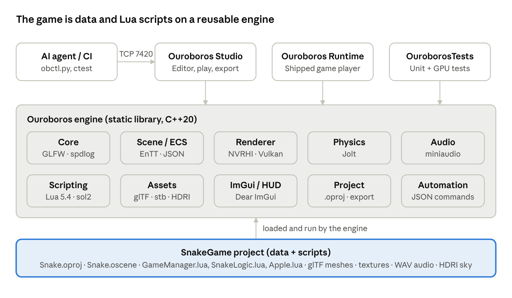

# Snake 3D — Software Requirements Specification (SRS)

Oct 21, 2026 · Tito Tamaro

## 1. Introduction

This SRS states the technical requirements Snake 3D, the Ouroboros engine, its editor and runtime must meet. It is the reference for developers, testers and AI agents, and refines the [BRD](BRD.md) and [FSD](FSD.md).

| Item | Value |
| --- | --- |
| Version / status | 1.0 · Draft for review |
| Source baseline | [titotamaro/Snake3D](https://github.com/titotamaro/Snake3D), commit 26f97f6 (16 Oct 2026) |
| Related documents | [Snake 3D — BRD](BRD.md); [Snake 3D — FSD](FSD.md); [`AGENTS.md`](../../AGENTS.md); [`README.md`](../../README.md) |
| Requirement IDs | SR-xx functional, NFR-xx non-functional; "shall" = mandatory |

**Definitions**

| Term | Meaning |
| --- | --- |
| ECS | Entity-Component-System; scenes are entities holding data components (EnTT) |
| NVRHI | NVIDIA Rendering Hardware Interface, an abstraction over Vulkan |
| PBR / IBL | Physically based rendering / image-based lighting from HDR sky images |
| PCSS | Percentage-closer soft shadows |
| SSAO | Screen-space ambient occlusion |
| Step | One grid move of the snake |
| Headless | Running without a window, for automation and CI |
| Agent API | The editor's local JSON-over-TCP control interface |

## 2. Overall description

The system is four executables built from one C++20 codebase: an engine library, an editor, a runtime player and a test runner. The game itself is data (scenes, assets) plus Lua scripts.

| Component | Type | Purpose |
| --- | --- | --- |
| Ouroboros | Static library | Engine: core, math, scene/ECS, renderer, assets, physics, audio, scripting, ImGui, project, automation |
| OuroborosEditor (Ouroboros Studio) | Executable | Scene editing, play mode, export, agent API server |
| OuroborosRuntime | Executable | Player shipped with exported games; no editing |
| OuroborosTests | Executable | doctest unit and GPU tests |
| SnakeGame/ | Project data | `Snake.oproj`, scenes, Lua scripts, meshes, textures, audio, HDRI |
| Tools/ | Python scripts | `GenerateAssets.py` (deterministic asset generation), `obctl.py` (agent CLI) |

**User classes:** players (runtime only), designers and engine developers (editor, source), AI agents and CI (headless editor/runtime, agent API).

**Design constraints**

- C++20, CMake ≥ 3.24, Hazel engine code style (PascalCase types, `m_` members, tabs, Allman braces).
- Smart-pointer ownership (`Ref<T>`, `Scope<T>`); no raw `new`/`delete` except Layers.
- Right-handed coordinates, Y up, −Z forward, metres, radians.
- Lua scripts are sandboxed: `io`, `os`, `debug`, `dofile`, `loadfile` and native modules are unavailable.

## 3. Architecture

All three executables link the same engine library; the Snake game adds no C++ of its own.

*System architecture · 3 executables, 10 engine subsystems, 1 game project*

The editor plays a copy of the scene: scripts update every frame, physics runs at a fixed 60 Hz (OnFixedUpdate → physics step → contact callbacks). Physics and scripts rescan the ECS registry each step, so components added at runtime take effect immediately.

## 4. Functional requirements

Requirements are grouped by subsystem; each traces to a BRD requirement. Gameplay behaviour is specified in FSD §4 and only its technical form is repeated here.

### 4.1 Game logic (BR-01–04, BR-09)

| ID | Requirement |
| --- | --- |
| SR-01 | Game rules shall live in `SnakeLogic.lua` with no engine calls, so they run in isolation under test. |
| SR-02 | `SnakeLogic.NewGame(size, initialLength, random)` shall require size ≥ 4 and clamp length to [1, size/2]. |
| SR-03 | `SnakeLogic.Step(state)` shall return exactly one event: `move`, `eat`, `win` or `dead`. |
| SR-04 | `SnakeLogic.QueueDirection` shall hold at most 2 turns and reject same or opposite headings. |
| SR-05 | Apple spawning shall pick uniformly from free cells using the injected random function, or return nil when none are free. |
| SR-06 | The game manager shall run as many fixed steps per frame as elapsed time requires (catch-up loop). |
| SR-07 | Step time shall equal max(MinStepTime, StepTime − SpeedUp × Score). |

### 4.2 Core and application

| ID | Requirement |
| --- | --- |
| SR-10 | The Application shall own the window (GLFW), graphics context, renderer, ImGui layer and audio, and call per frame: OnUpdate → OnRender → OnImGuiRender → present. |
| SR-11 | Every entity shall have a 53-bit UUID, a tag and a transform. |
| SR-12 | Headless runs shall advance exactly 1/60 s per frame so results are deterministic. |
| SR-13 | Logging shall separate engine (`OB_CORE_*`) and game/script (`OB_*`) output. |

### 4.3 Rendering (BR-13)

| ID | Requirement |
| --- | --- |
| SR-20 | Rendering shall use Vulkan 1.3 through NVRHI; HLSL shaders compiled to SPIR-V by DXC at build time. |
| SR-21 | Meshes shall load from glTF 2.0 with materials and textures, or from primitives (Cube, Sphere, Plane). |
| SR-22 | The frame shall run: 4-cascade PCSS shadows → depth/normal/entity-ID pre-pass → SSAO + bilateral blur → forward PBR (GGX, IBL, point lights) → sky → editor grid → ACES tonemap, sRGB, dithering, selection outline. |
| SR-23 | IBL shall derive irradiance, prefiltered specular and a BRDF LUT from an equirectangular HDRI on the GPU. |
| SR-24 | Debug views 0–5 shall be selectable for inspection. |
| SR-25 | Scripts shall draw screen-space HUD text with size, colour and 9 anchor positions. |

### 4.4 Physics

| ID | Requirement |
| --- | --- |
| SR-30 | Physics shall use Jolt with RigidBody, BoxCollider and SphereCollider components, stepped at a fixed 60 Hz. |
| SR-31 | Adding or removing physics components at runtime shall create or destroy bodies in the same step. |
| SR-32 | Collision and trigger begin/end callbacks shall reach scripts after each step. |
| SR-33 | Scripts shall apply forces, impulses, torque, set velocities and raycast. |

### 4.5 Audio (BR-05)

| ID | Requirement |
| --- | --- |
| SR-40 | Audio shall use miniaudio; AudioSource supports clip, volume, loop, play-on-start and spatial mode. |
| SR-41 | Scripts shall play one-shot sounds and set master volume. |
| SR-42 | `--no-audio` shall run without an audio device. |

### 4.6 Scripting (BR-11)

| ID | Requirement |
| --- | --- |
| SR-50 | Scripting shall use Lua 5.4 via sol2; a script returns a class table instantiated per entity with `Properties` overridable per entity. |
| SR-51 | Callbacks: OnCreate, OnUpdate, OnFixedUpdate, OnDestroy, OnCollisionBegin/End, OnTriggerBegin/End. |
| SR-52 | A script error shall be logged and disable only the failing callback on that instance. |
| SR-53 | `require` shall resolve modules from `Assets/` or `Assets/Scripts/`. |
| SR-54 | The API shall expose math, time, random, input, scene, entity/component, physics, audio, UI and application functions (§7.2). |

### 4.7 Editor and automation (BR-10, BR-12)

| ID | Requirement |
| --- | --- |
| SR-60 | The editor shall edit every component through a type-erased ComponentRegistry. |
| SR-61 | Play mode shall run on a copy of the scene and discard it on stop. |
| SR-62 | The command server shall listen on loopback only (default port 7420), answer requests in order, and defer replies for wait/step/screenshot/tap commands. |
| SR-63 | Every editor capability shall be available as an agent command (§7.3). |

### 4.8 Project and export (BR-07)

| ID | Requirement |
| --- | --- |
| SR-70 | A project file shall define name, start scene, asset directory and window settings. |
| SR-71 | Export shall copy the runtime, engine resources and assets to an output folder and write `Game.oproj`, reporting the file count or a failure reason. |

## 5. Platform and operating environment

The only hard runtime requirement is a GPU and driver supporting Vulkan 1.3 (BR-06).

| Area | Requirement |
| --- | --- |
| Operating systems | Windows 10/11, Linux (Ubuntu 24.04+), macOS |
| GPU | Vulkan 1.3 driver (macOS through a Vulkan portability layer) |
| Input | Keyboard; mouse for the editor |
| Display | 1280 × 720 default window; any size via `--size` |
| Build toolchain | CMake ≥ 3.24; C++20 compiler (Visual Studio 2022 on Windows; Ninja Multi-Config on Linux/macOS); Vulkan SDK with `VULKAN_SDK` set (for DXC) |
| Build presets | `windows`, `ninja`; configurations Debug and Release |
| Output | `build/<preset>/bin/<Config>/`, with engine `Resources/` copied beside each executable |

Minimum CPU, RAM and disk figures have not been measured yet — open question for the release checklist.

## 6. Non-functional requirements

Reliability and testability carry the most weight: the brief calls for production-grade software with no shortcuts (BR-08).

| ID | Category | Requirement |
| --- | --- | --- |
| NFR-01 | Reliability | The engine shall never crash on bad user data (scenes, scripts, assets, commands); recoverable failures return `bool`/`optional` with an error and are logged. |
| NFR-02 | Reliability | Test runs shall have zero logged errors and zero Vulkan/NVRHI validation errors. |
| NFR-03 | Fault isolation | A failing script callback shall not affect other entities or flood the log. |
| NFR-04 | Performance | Gameplay shall run at display refresh (VSync, 60 Hz target); physics at a fixed 60 Hz independent of frame rate. |
| NFR-05 | Responsiveness | Input shall be read every frame; queued turns guarantee no keypress lost between steps. |
| NFR-06 | Determinism | Headless runs with the same inputs shall produce the same results; assets regenerate byte-identically. |
| NFR-07 | Maintainability | Code shall follow `.clang-format` and Hazel conventions; public headers document each class contract. |
| NFR-08 | Code quality | Builds shall treat warnings as errors (`/W4 /WX`, `-Wall -Wextra -Werror`) in Debug and Release. |
| NFR-09 | Testability | New engine code needs unit tests; new components, script functions and agent commands need feature or automation tests. |
| NFR-10 | Security | The agent server shall bind to loopback only and be disableable (`--no-server`); scripts run sandboxed. |
| NFR-11 | Portability | One codebase shall build on Windows, Linux and macOS with pinned dependency versions. |
| NFR-12 | Usability | A first-time player shall start a game with one keypress; controls shown on the Ready screen. |

## 7. External interfaces

Three interfaces are stable contracts: the file formats, the Lua scripting API and the agent API.

### 7.1 File formats

| Format | Structure |
| --- | --- |
| Project `.oproj` (JSON) | `Name`, `StartScene`, `AssetDirectory`, `Window {Title, Width, Height, Fullscreen, VSync}` |
| Scene `.oscene` (JSON) | `{"Ouroboros": "Scene", "Version": 1, "Name", "Entities": [{"UUID", "Components": {"<Type>": {…}}}]}`; field names match C++ component fields |
| Meshes | glTF 2.0 (`.gltf` + `.bin`) |
| Textures / environments | PNG (via stb); equirectangular `.hdr` |
| Audio | WAV |
| Asset paths | Relative to the project's `Assets/` directory |

Components: ID, Tag, Transform, Camera, MeshRenderer, DirectionalLight, PointLight, SkyLight, RigidBody, BoxCollider, SphereCollider, Script, AudioSource.

**Snake scene entities:** Main Camera, Sun, Sky, Board, Game (GameManager script + music), Snake Head, Apple (Apple script), Apple Glow. Walls and body segments are created at runtime.

### 7.2 Lua scripting API

| Module | Functions |
| --- | --- |
| Math | `vec2/3/4`, `quat`, `Math.Pi Lerp Clamp Radians Degrees Sign MoveTowards` |
| Core | `Log.*`, `Time.*`, `Random.Seed Int Float`, `Application.Quit GetViewportSize` |
| Input | `Input.IsKeyDown/Pressed/Released`, mouse buttons, position, delta, scroll; `Key.*`, `Mouse.*` |
| Scene | `Scene.CreateEntity DestroyEntity DuplicateEntity FindEntityByName GetEntityByID GetEntities GetEntitiesWithComponent GetPrimaryCamera Load` |
| Entity | `HasComponent AddComponent RemoveComponent GetComponentData SetComponentData AddScript Destroy`; component proxies (`e.Transform`, `e.RigidBody`, …) |
| Physics | `Physics.GetGravity SetGravity Raycast` |
| Audio | `Audio.PlayOneShot SetMasterVolume GetMasterVolume` |
| UI | `UI.Text(text, x, y, {Size, Color, Anchor})` |

### 7.3 Agent API (TCP, 127.0.0.1:7420)

Request: `{"id": 1, "cmd": "entity.list", "args": {}}` (one per line). Reply: `{"id": 1, "ok": true, "result": …}` or `{"id": 1, "ok": false, "error": "…"}`.

| Area | Commands |
| --- | --- |
| General | `ping`, `help` |
| Editor | `editor.state play stop pause step wait select camera.get camera.set camera.focus gizmo screenshot viewport.resize quit`, `game.ui` |
| Scene | `scene.info get set new open save createPreset` |
| Entities | `entity.list get create destroy duplicate rename` |
| Components | `component.types get add set remove` |
| Scripts / input | `script.exec errors`, `input.key tap` |
| Project / assets | `project.info set save export`, `asset.list reload` |
| Renderer / log | `renderer.settings.get settings.set stats`, `log.get clear` |

### 7.4 Command-line interface

| Executable | Options |
| --- | --- |
| OuroborosRuntime | `--project --scene --headless --frames --screenshot --size --test --validation --debug-view --no-audio` |
| OuroborosEditor | `--project --headless --size --port --no-server --exec --exit-after-exec --validation --no-audio` |

## 8. Verification

Every requirement is verified by an automated `ctest` suite, except HUD and audio feel, which need a manual playtest. Run all with `ctest --preset <preset>`; `-L unit` for CPU-only, `-LE gpu` on machines without a GPU.

| Test | Covers | Requirements |
| --- | --- | --- |
| UnitTests | Core, Math, Scene (ECS, registry, serialization), Scripting (Lua API, errors, SnakeLogic rules), Physics, Audio, Assets, Project/export, Automation (commands, TCP) | SR-01–07, SR-10–13, SR-30–33, SR-40–42, SR-50–54, SR-62, SR-70 |
| GpuTests | Headless Vulkan device, shaders, mesh/texture/IBL caches, scene render, picking, readback, all debug views; fails on any validation error | SR-20–25, NFR-02 |
| FeatureTestScene | Every component and the whole scripting API (128 checks) | SR-21, SR-30–33, SR-40–41, SR-50–54 |
| SnakeGameSmoke | Start scene for 240 frames with validation on | SR-03, SR-06, NFR-01–02 |
| EditorAutomation | Headless editor driven through the agent API | SR-60–63 |
| ExportGame → RunExportedGame | Export, then run the exported executable | SR-71, BR-07 |
| Manual playtest | HUD, pause, restart delay, sounds, crash effect, camera follow | FSD §4.6–4.8, NFR-12 |

**Release gate:** all suites pass in Debug and Release on each target platform, with zero errors and zero validation errors.

## 9. Dependencies and licensing

All dependencies are permissive open source, fetched at pinned versions by `cmake/Dependencies.cmake` (BR-14). Licence names below are the projects' usual licences; confirm against each pinned version before release.

| Dependency | Use | Licence |
| --- | --- | --- |
| GLFW | Window and input | zlib |
| NVRHI | Vulkan abstraction | MIT |
| glm | Math | MIT |
| EnTT | ECS | MIT |
| Jolt Physics | Physics | MIT |
| Lua 5.4 + sol2 | Scripting | MIT |
| miniaudio | Audio | Public domain / MIT-0 |
| Dear ImGui + ImGuizmo | Editor UI, gizmo, HUD | MIT |
| cgltf, stb | glTF and image loading | MIT / public domain |
| spdlog, nlohmann/json | Logging, JSON | MIT |
| doctest | Unit tests | MIT |
| Vulkan SDK (DXC) | Shader compilation (build only) | Apache 2.0 / LLVM |

**Assets:** the sky HDRI "Kloofendal 48d Partly Cloudy (Pure Sky)" is CC0 from [Poly Haven](https://polyhaven.com/a/kloofendal_48d_partly_cloudy_puresky). All meshes, textures and sounds are generated by `Tools/GenerateAssets.py`, so the project owns them outright.
